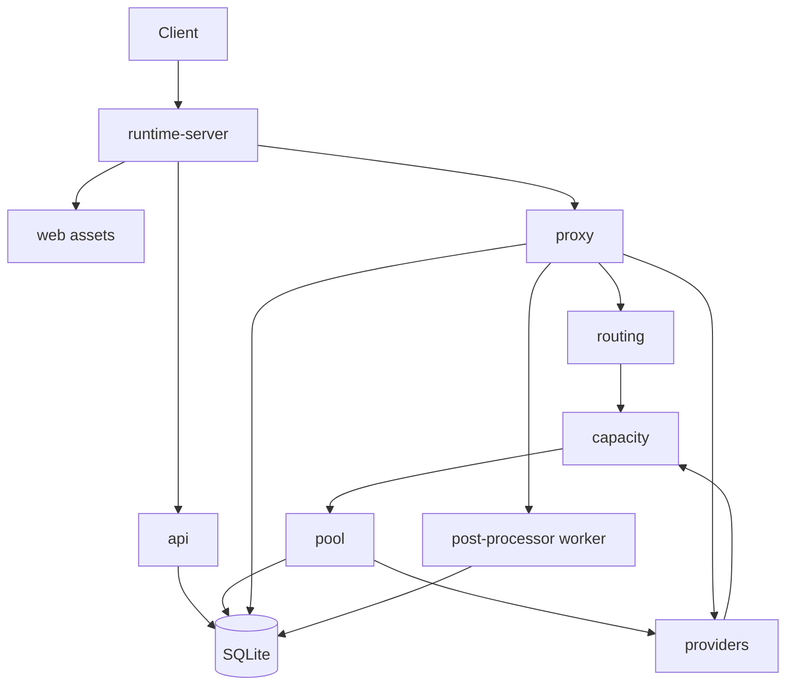
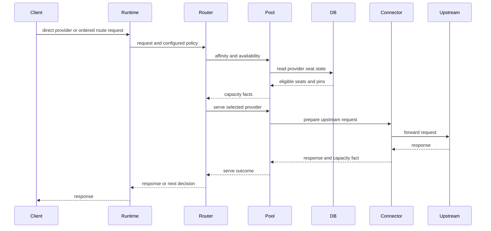
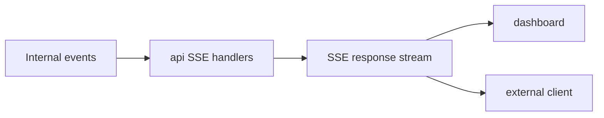
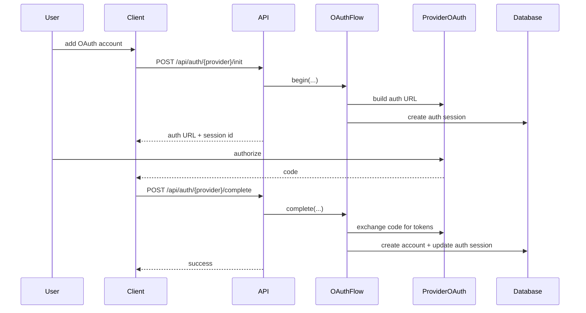
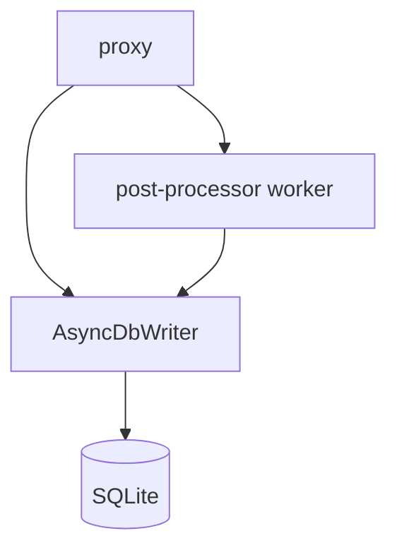

# Data Flow

## Overview

This document describes how requests and management operations move through agent-smith today.

The major flows are:

- management/API requests
- proxied provider requests
- websocket proxy requests
- request/log event streaming
- OAuth account onboarding

An optional [HTTPS entrance](https-edge.md) routes authenticated device
inference through a protected Unix socket to this same runtime. Its allowlist
excludes management/OAuth; the pool checks the current hash-only device registry
before selecting an account. Deleting an entry stops subsequent requests.

## Runtime Flow



## HTTP Management Requests

Management endpoints follow this path:

1. request arrives at the Bun server
2. `runtime-server` sends it to `APIRouter`
3. a pre-instantiated handler performs validation and database/repository work
4. the handler returns JSON or SSE via `http`

Examples:

- `/health`
- `/api/accounts`
- `/api/stats`
- `/api/analytics`
- `/api/logs/stream`
- `/api/requests`

## Router and Pool boundary

The Router in `packages/routing` chooses the ordered provider, wait or fallback
policy and conversation preference. Each `ProviderSupply` in `packages/pool`
owns that provider’s eligible seats, admission, quota facts and account pins.
The Router talks to it through `RoutedProvider` in `packages/capacity`: it can
ask for availability or status and request a serve/session attempt. A
connector’s `CapacitySource` translates an upstream response into a capacity
fact. The Router decides what to do with that fact. Configuration updates
replace settings in the running runtime without discarding its live state.

## Proxy Request Flow

Provider-native requests follow this path:

1. A request arrives at a direct provider path or `/v1/pool/<wire>/...`.
2. The edge resolves the provider or ordered route and gives the Router the
   request and configured policy.
3. The Router asks the relevant `RoutedProvider` for affinity and availability,
   then decides whether to serve, wait, offer a choice or move forward.
4. That provider’s Pool selects eligible accounts and applies admission.
5. Its connector prepares the upstream request; the Pool executes the attempt.
6. Connector capacity facts and the result return to the Router, which decides the
   next step. Request events and persistence work are scheduled.

### Proxy Forwarding Sequence



## Interactive Claude provider choice

The optional Claude wrapper adds an Agent-smith companion only to wrapped
Claude Code sessions. An interactive pool request stops at a classified
provider block and returns private, versioned chooser details to that
companion. The companion asks the person outside the transcript, then resends
the unchanged request with a validated configured-provider choice. The proxy
removes all chooser controls before upstream forwarding. A successful response
returns the factual provider/model for the companion's status row. Unwrapped
clients stay on their current provider and receive its capacity response; the
proxy never silently moves them to a lower-ranked provider. A private
`routing.callers.<device>.allow_fallbacks` policy is the one exception for a named unattended
device: `true` moves only forward through configured providers after a
block. It is decided from the authenticated device identity, never a client
header.

The companion transports this UI only. `routing` decides when a configured
provider is eligible to offer or pin, `capacity` represents the upstream block,
and the pool supplies the underlying account state. No automatic provider
switch is made for an interactive conversation.

## WebSocket Flow

Websocket-capable provider routes go through the same runtime routing layer, but switch into the websocket proxy path when the request is an upgrade request.

```mermaid
flowchart TD
    REQ[Incoming /v1/{provider}/... request]
    UPGRADE{WebSocket upgrade?}
    WS[websocket proxy handler]
    HTTP[standard HTTP proxy path]
    UPSTREAM[Upstream provider]

    REQ --> UPGRADE
    UPGRADE -->|yes| WS
    UPGRADE -->|no| HTTP
    WS --> UPSTREAM
    HTTP --> UPSTREAM
```

## Response and Usage Processing

For HTTP proxy traffic:

- the proxy handles immediate forwarding concerns
- account/rate-limit state is updated
- request metadata is queued for persistence
- background post-processing extracts additional usage, payload, and summary information

For streaming and websocket traffic:

- the proxy emits chunk/summary payloads to the worker
- the worker parses provider-specific usage events
- final summaries and payloads are persisted asynchronously

## Event Streaming

agent-smith exposes two real-time SSE streams:

- `/api/requests/stream`
- `/api/logs/stream`

### Event Streaming Flow



Request events come from the request-event bus; log events come from the log bus.

## OAuth Account Onboarding Flow

OAuth account onboarding is provider-scoped.



Important note:

- auth flow state is stored in `auth_sessions`
- callback forwarding is provider-scoped and managed by `api`

## Database Writes During Normal Operation

### `accounts`

Updated for:

- account creation
- token refresh
- request/session counters
- pause/resume state
- rate-limit metadata

### `requests`

Updated for:

- request metadata
- status and timing
- model selection
- token and cost analytics
- failover attempt counts

### `request_payloads`

Updated for:

- request metadata payload persistence (bodies are stored as `null`)
- debugging and request inspection

### `auth_sessions`

Updated for:

- OAuth onboarding state
- completion status transitions
- session expiry management

## Background Work

Background processing exists to keep the request path responsive.

The main mechanisms are:

- `AsyncDbWriter` for non-blocking writes
- the proxy post-processor worker for stream/websocket usage extraction

### Background Persistence Flow



This keeps forwarding latency low while preserving detailed observability.

## Design Summary

Today’s data flow is intentionally simple:

- `runtime-server` routes
- `api` manages the control plane
- `proxy` manages the data plane
- `providers` own provider-specific parsing/auth details
- `database` persists state and analytics inputs
- dashboard and TUI consume the same management surface
