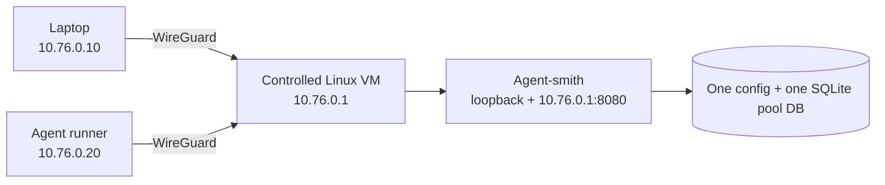

# Private shared pool over WireGuard

Use this shape when laptops and an agent runner need one private Agent-smith
pool. It has one server process, one configuration file and one SQLite database.
Clients never receive provider tokens or run a token refresher.

This guide is a deployment recipe, not a new tenancy system. WireGuard gives
each machine its own network key, but Agent-smith's current forwarding key does
not identify individual callers or provide per-caller fairness.

## Choose the host

A WireGuard endpoint needs a UDP listener and permission to create a tunnel
interface. A managed HTTP service is not enough. For example, Render web
services expose one public HTTP port, not a public UDP listener; use a small,
controlled Linux VM when the current host cannot provide both requirements.

Every participating machine must be able to create the WireGuard tunnel. If an
agent runner is on a platform that cannot do that, move that runner to the VM
or use an approved private connector. Do not work around the limitation by
publishing the proxy port.

The VM needs a persistent local disk. Run Agent-smith under its own Unix user
or container and keep the SQLite database, configuration and provider tokens
owned only by that identity.



## Give every machine its own peer

Use one WireGuard private key and one `/32` address per machine. Do not copy a
peer file between devices.

| Machine | WireGuard address | Server peer rule |
| --- | --- | --- |
| Pool VM | `10.76.0.1/24` | endpoint |
| Laptop | `10.76.0.10/32` | `AllowedIPs = 10.76.0.10/32` |
| Agent runner | `10.76.0.20/32` | `AllowedIPs = 10.76.0.20/32` |

The pool VM's `wg0.conf` has one peer block per client. Replace every
placeholder below with a value from that specific peer; private keys stay in
root-owned, mode-600 files.

```ini
[Interface]
Address = 10.76.0.1/24
ListenPort = 51820
PrivateKey = <pool-vm-private-key>

[Peer]
# laptop-01
PublicKey = <laptop-01-public-key>
AllowedIPs = 10.76.0.10/32

[Peer]
# agent-runner-01
PublicKey = <agent-runner-01-public-key>
AllowedIPs = 10.76.0.20/32
```

A laptop's editable peer file contains only its own private key, the VM public
key and the private-network route:

```ini
[Interface]
Address = 10.76.0.10/32
PrivateKey = <laptop-01-private-key>

[Peer]
PublicKey = <pool-vm-public-key>
Endpoint = <pool-vm-public-name>:51820
AllowedIPs = 10.76.0.0/24
PersistentKeepalive = 25
```

The agent runner uses the same shape with `10.76.0.20/32` and its own key.

## Keep the proxy private

On the VM, set the listener addresses explicitly. `CF_BIND_HOSTS` is a
comma-separated list; Agent-smith starts one listener per address, but they
share the same runtime and database.

```text
CF_BIND_HOSTS=127.0.0.1,10.76.0.1
CF_TRUST_LOOPBACK=false
CF_PROXY_KEY=<forwarding-only-secret>
CF_ADMIN_KEY=<different-admin-secret>
ccflare_CONFIG_PATH=/var/lib/agent-smith/config.json
ccflare_DB_PATH=/var/lib/agent-smith/pool.db
```

Keep the admin key on the VM. A proxy key can forward a provider request but
cannot make management writes. `CF_TRUST_LOOPBACK=false` requires a key even
for loopback HTTP; use the protected Unix control socket for same-host operator
tools where appropriate.

The host firewall has only three relevant rules:

- allow UDP `51820` for WireGuard;
- allow TCP `8080` only on `wg0` and loopback;
- reject TCP `8080` on the public interface.

Do not publish a load-balancer, reverse-proxy, container or cloud-service port
for Agent-smith. WireGuard already encrypts the private path.

`CF_BIND_HOSTS` needs Linux to bind one port on several explicit addresses. A
macOS laptop is a WireGuard client, not the pool host.

## Configure clients without copied provider tokens

Copy the shipped
[`private-network-client.json`](../examples/config/private-network-client.json)
to the client's private Agent-smith config and edit only its `client` section.
The file supplies the private origin and a path to an owner-only forwarding-key
file:

```json
{
  "client": {
    "base_url": "http://10.76.0.1:8080",
    "proxy_key_file": "~/.config/ccflare/team-pool.key"
  }
}
```

The forwarding key is ordinary proxy authentication, not a provider token. The
client has no SQLite pool database, OAuth refresh token or local refresher.
Run `agent-smith install-client` after editing this file. It creates the Claude
Code and Codex wrappers from the configured origin and key file; edit the JSON
and rerun the installer when the address changes instead of editing a generated
shell script.

The existing single forwarding key is appropriate only for a tightly controlled
caller group. It is not per-person attribution. Do not claim that WireGuard
peer names provide Agent-smith tenancy; use per-client proxy keys before
opening the pool to a broader group.

## Revoke and prove

To remove a device, delete its peer block from the VM's WireGuard configuration
and apply the change. Its private address no longer has a route into the pool.
If that device held the forwarding key, rotate the forwarding key too; removing
the peer alone is sufficient only while the proxy remains private.

Record these checks for each rollout without placing credentials, prompts or
provider responses in the record:

| Check | Expected result |
| --- | --- |
| Laptop health request with its forwarding key | `200` over `10.76.0.1` |
| Agent-runner health request with its forwarding key | `200` over `10.76.0.1` |
| One approved authenticated proxy request from each caller | both are handled by the one pool server |
| Public-interface connection to TCP `8080` | refused by the firewall; no HTTP response |
| Removed peer tries health or a proxy request | no WireGuard path; cannot connect |
| Server-side state inspection | one configured DB path and one request/account state, with no client-side pool database |

Run the authenticated proxy calls only after the normal provider, canary and
authorization gates for the pool are satisfied.
